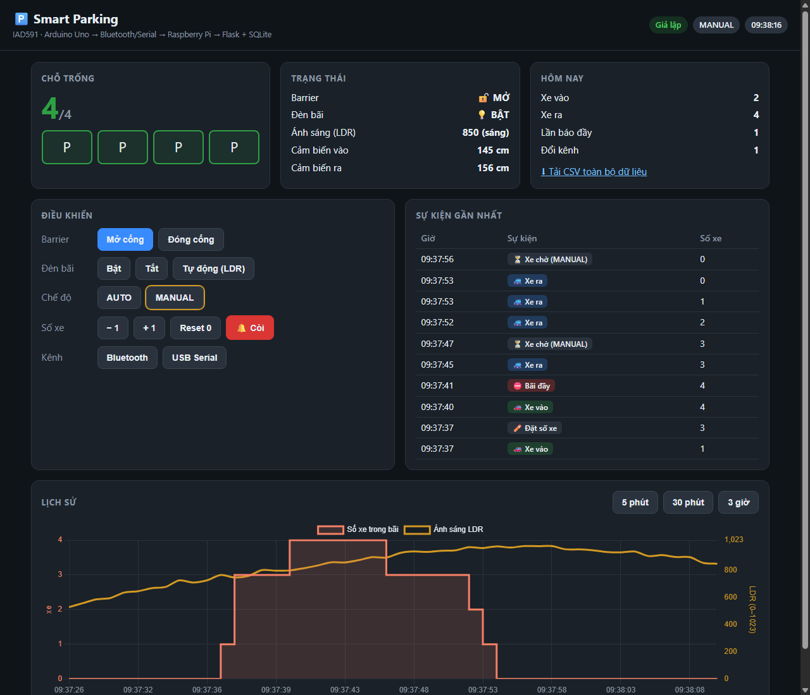

# 🅿️ Smart Parking — Đồ án cuối kỳ IAD591

Bãi đỗ xe 4 chỗ: Arduino Uno đếm xe bằng cảm biến siêu âm, mở barrier bằng servo, bật đèn bãi theo cảm biến ánh sáng. Dữ liệu gửi qua **Bluetooth HC-05** (dự phòng **USB Serial**) lên **Raspberry Pi 3B+**. Pi lưu vào **SQLite** và hiển thị trên **Flask dashboard** (biểu đồ, lịch sử, điều khiển).

```
[HC-SR04 vào] [HC-SR04 ra] [LDR]            ┌──────────── Raspberry Pi 3B+ ─────────────┐
        │          │        │                │ link.py  : BT /dev/rfcomm0 → USB ttyACM0 │
        ▼          ▼        ▼   JSON 1 s/lần │ db.py    : SQLite data/parking.db        │
   ┌──────────── Arduino Uno ────────┐ ────▶ │ app.py   : Flask :5000                   │ ◀──▶ Trình duyệt
   │ logic: đếm xe, mở cổng, đèn bãi │ ◀──── │           /api/latest /history /cmd      │      (dashboard)
   └─────────────────────────────────┘ lệnh  └──────────────────────────────────────────┘
        │        │       │      │
     Servo   LCD1602  LED x3  Buzzer
```

## Đối chiếu rubric 9–10

| Hạng mục | Yêu cầu 9–10 | Đồ án |
|---|---|---|
| Arduino | 2 cảm biến + LCD1602 + 1 actuator | HC-SR04 ×2 + LDR, LCD1602 I2C, servo + LED + buzzer |
| Giao tiếp | Bluetooth (backup Serial) | HC-05; mất BT 5 s → tự chuyển sang USB; nút chuyển kênh trên web |
| Raspberry Pi | Flask dashboard + điều khiển + LED 4 số | Flask + điều khiển + **LCD1602 gắn trên Pi** (thay LED 4 số vì lab không có): chỗ trống, kênh, xe vào/ra, giờ |
| Lưu dữ liệu | SQLite | `readings`, `events`, `commands` (`pi/schema.sql`) |
| Dashboard | hiện tại + lịch sử + chart | thẻ trạng thái, bảng sự kiện, Chart.js 5 phút / 30 phút / 3 giờ |
| Điều khiển từ GUI | bắt buộc | cổng, đèn, AUTO/MANUAL, số xe, còi, kênh |
| Thưởng | đẹp · chart · BT ổn định · sáng tạo | dark UI, 2 trục chart, tự chuyển kênh + khôi phục số xe khi Arduino reset, xuất CSV |

## Sơ đồ chân Arduino Uno

📌 Bảng đầy đủ (Arduino + Pi + sơ đồ chia áp + checklist): [docs/PINOUT.md](docs/PINOUT.md)

| Linh kiện | Chân linh kiện | Arduino |
|---|---|---|
| HC-SR04 cổng **vào** | VCC / GND / Trig / Echo | 5V / GND / **D7** / **D6** |
| HC-SR04 cổng **ra** | VCC / GND / Trig / Echo | 5V / GND / **D5** / **D4** |
| LDR | một đầu → 5V, đầu kia → **A0** và điện trở **10k** xuống GND | A0 |
| Servo (barrier) | nâu GND · đỏ 5V · cam tín hiệu | **D9** |
| LCD1602 I2C | SDA / SCL / VCC / GND | **A4** / **A5** / 5V / GND |
| LED xanh (còn chỗ) | anode qua 220Ω | **D2** |
| LED đỏ (hết chỗ) | anode qua 220Ω | **D3** |
| LED đèn bãi | anode qua 220Ω | **D12** |
| Buzzer | + / − | **D8** / GND |
| HC-05 | VCC / GND | 5V / GND |
| HC-05 TXD | → | **D10** (SoftwareSerial RX) |
| HC-05 RXD | ← **chia áp**: D11 → 1kΩ → RXD → 2kΩ → GND | **D11** |

⚠️ HC-05 nhận logic 3.3V nên **bắt buộc chia áp** chân RXD. Servo kéo dòng lớn: nếu Arduino reset khi servo quay thì cấp 5V riêng cho servo và **nối chung GND**.
Không lắp HC-SR04 thứ hai thì đặt `#define USE_EXIT_SENSOR 0`; xe ra khi đó trừ bằng nút **−1** trên web.

## Chạy

### 1. Arduino
1. Arduino IDE → Library Manager → cài **LiquidCrystal I2C** (Frank de Brabander).
2. Mở `arduino/smart_parking/smart_parking.ino`, board **Arduino Uno**, upload (HC-05 nằm ở D10/D11 nên không cần rút khi nạp code).
3. Serial Monitor 9600 → thấy mỗi giây một dòng `{"d1":..,"ldr":..,"cars":0,...}`.
4. LCD trắng/ô vuông → vặn biến trở sau LCD; không hiện chữ → đổi `0x27` thành `0x3F`.

### 2. Raspberry Pi
```bash
git clone <repo-url> && cd <repo>/pi
pip3 install -r requirements.txt      # hoac: sudo apt install python3-flask python3-serial
python3 app.py                         # mo http://<IP-Pi>:5000
```
Chưa có mạch hoặc thử trên laptop: `python app.py --sim`.
Test: `python3 -m unittest test_link`.

### 2b. LCD1602 trên Pi (thay LED 4 số)
| LCD1602 I2C | Raspberry Pi 3B+ |
|---|---|
| GND | chân 6 (GND) |
| VCC | chân 2 (5V) |
| SDA | chân 3 (GPIO2) |
| SCL | chân 5 (GPIO3) |

```bash
sudo raspi-config        # Interface Options -> I2C -> Enable, rồi reboot
sudo apt install -y i2c-tools python3-smbus
i2cdetect -y 1           # thấy 27 hoặc 3f
python3 app.py --lcd-addr 0x3f   # nếu địa chỉ là 3f; mặc định 0x27
```
LCD hiện `Trong 3/4    BT` và `V:12 R:9   14:05` (chỗ trống, kênh truyền, xe vào/ra hôm nay, giờ). Không cắm LCD thì app in `[lcd] khong dung LCD tren Pi` và vẫn chạy bình thường; tắt hẳn bằng `--no-lcd`.
⚠️ Module I2C kéo SDA/SCL lên 5V qua điện trở 4.7k: thường chạy được với Pi, nhưng an toàn nhất là cấp VCC 3.3V (chân 1) nếu chữ vẫn đủ rõ.

### 3. Ghép Bluetooth HC-05 với Pi (một lần)
```bash
bluetoothctl
  power on
  agent on
  scan on                 # cho thay HC-05 -> ghi lai MAC  98:D3:xx:xx:xx:xx
  pair 98:D3:xx:xx:xx:xx  # PIN 1234 (hoac 0000)
  trust 98:D3:xx:xx:xx:xx
  quit
sudo rfcomm bind 0 98:D3:xx:xx:xx:xx 1     # tao /dev/rfcomm0
ls -l /dev/rfcomm0
```
`app.py` tự thử theo thứ tự `/dev/rfcomm0` → `/dev/ttyACM0` → `/dev/ttyUSB0`. Đổi cổng bằng biến môi trường: `BT_PORT=/dev/rfcomm1 USB_PORT=/dev/ttyUSB0 python3 app.py`.
Đèn HC-05 nháy chậm 2 lần mỗi ~2 s là đã kết nối.

## Giao thức

Arduino → Pi (mỗi dòng 1 JSON):
```json
{"d1":23,"d2":400,"ldr":512,"cars":2,"cap":4,"gate":0,"light":1,"mode":"AUTO"}
{"ev":"car_in","cars":3}
```
Sự kiện: `boot`, `car_in`, `car_out`, `car_wait`, `full`, `gate_manual_open`, `gate_manual_close`, `cars_set`, `bad_cmd`.

Pi → Arduino (1 dòng text): `GATE:OPEN`, `GATE:CLOSE`, `LIGHT:ON`, `LIGHT:OFF`, `LIGHT:AUTO`, `MODE:AUTO`, `MODE:MANUAL`, `CARS:<n>`, `BUZZ`, `PING`.

Logic cục bộ trên Arduino:
- **AUTO:** xe tới cổng vào (< 10 cm) mà còn chỗ thì mở barrier 3 s và tăng số xe. Bãi đầy thì giữ cổng đóng, kêu còi, bật LED đỏ. Xe ra thì giảm số xe và mở cổng.
- **MANUAL:** xe tới thì báo `car_wait`. Người trực bấm **Mở cổng** trên web, lúc đó mới tính xe vào.
- **Đèn bãi:** LDR < 600 thì bật, > 650 thì tắt (đo trong lab: sáng khoảng 850, che tay khoảng 400); có thể ghi đè bằng nút Bật/Tắt trên web.

## API Flask
| Route | Mô tả |
|---|---|
| `GET /` | dashboard |
| `GET /api/latest` | trạng thái mới nhất + kênh (`bt` / `serial` / `offline`) |
| `GET /api/history?min=30` | lịch sử N phút (cho biểu đồ) |
| `GET /api/events` | 20 sự kiện gần nhất + thống kê hôm nay |
| `POST /api/cmd` `{"cmd":"GATE:OPEN"}` | gửi lệnh xuống Arduino; `LINK:BT` / `LINK:SERIAL` để đổi kênh |
| `GET /export.csv` | tải toàn bộ bảng `readings` |

Xem DB: `sqlite3 pi/data/parking.db "select * from events order by id desc limit 10;"`

## Cấu trúc
```
arduino/smart_parking/smart_parking.ino   Device layer
pi/app.py          Flask (Application layer)
pi/link.py         Gateway: doc BT/Serial, tu chuyen kenh, gui lenh
pi/pi_lcd.py       LCD1602 I2C tren Pi (thay LED 4 so)
pi/db.py           SQLite
pi/schema.sql      Database schema
pi/sim.py          Arduino gia lap
pi/test_link.py    unit test
pi/templates/ pi/static/   dashboard (Chart.js dong goi san, khong can Internet)
docs/PLAN.md       ke hoach + timeline 5 gio + kich ban video
```

## Ảnh dashboard (chế độ giả lập)

